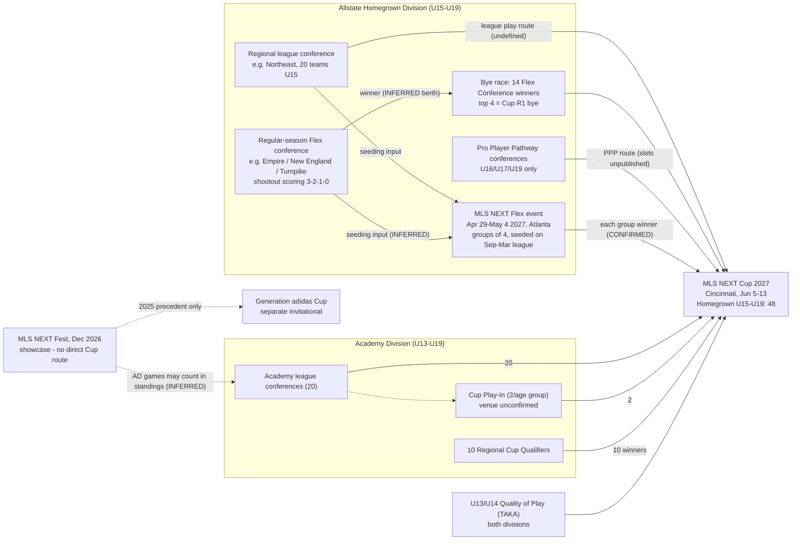

# Win your Flex conference to reach Cincinnati

For a U15 Allstate Homegrown team in the Northeast, the 2027 MLS NEXT Cup has **two routes that official text clearly describes, and a third route that is named but never defined.** The first is to **finish first in your regular-season Flex conference.** For Northeast U15 teams that means Empire, New England or Turnpike, not the 20-team Northeast table. MLS says the "14 regular season Flex Conference winners" will "enter MLS NEXT Cup", the top four with a first-round bye ([MLS NEXT](https://www.mlssoccer.com/mlsnext/news/mls-next-announces-key-dates-and-expanded-national-events-for-2026-27-season)). The second is to **win a group of four at the MLS NEXT Flex event** (Atlanta, April 29–May 4, 2027), where "the winner of each group will automatically clinch a spot" (same source). The third is "league play". It is listed as a Homegrown route, but MLS publishes no rank cutoff, no slot count and no conference allocation for it. The Pro Player Pathway route does not apply at U15: MissingTable's own production data shows no U15 PPP division. The Homegrown U15 Cup field grows from **32 to 48 teams**, but MLS has not said how those 48 places split across league play, the Pro Player Pathway and Flex. MLS has also published no 2026–27 Homegrown rulebook that we could find, so tiebreakers, Flex entry criteria and the Flex conference count are unresolved. The official text says 14 Flex conferences; MissingTable measures 13. For MissingTable, this means qualification must be modelled as **versioned, sourced, partly unknown rules**. A null slot count must never render as zero.

## Six 2026–27 rules MLS actually published

All of the following is **CONFIRMED** in the 2026–27 national-events release. The release is undated on mlssoccer.com, and SoccerWire reproduced it on **2026-10-05** ([MLS NEXT](https://www.mlssoccer.com/mlsnext/news/mls-next-announces-key-dates-and-expanded-national-events-for-2026-27-season); [SoccerWire](https://www.soccerwire.com/news/mls-next-announces-details-on-expanded-national-events-slate-for-2026-27/); [MLS key dates](https://www.mlssoccer.com/news/2026-27-mls-next-schedule-key-dates-to-know)). MLS NEXT runs **two tiers for a second season**: the Allstate Homegrown Division, which is all 30 MLS academies plus Elite Academies, and the Academy Division ([MLS NEXT kickoff](https://www.mlssoccer.com/mlsnext/news/mls-next-kicks-off-2026-27-season-developing-future-stars)). Both tiers compete in **six age groups: U13, U14, U15, U16, U17 and U19.** There is no U18 bracket, because MLS academy U18 teams play up into U19. The play-up rule (U15→U16, U16→U17, U18→U19) was set in 2025–26 ([MLS NEXT](https://www.mlssoccer.com/mlsnext/news/mls-next-announces-transformative-sporting-initiatives-for-the-2025-26-season)). For 2026–27 it is INFERRED, carried forward and backed by a club release ([Revolution](https://www.revolutionsoccer.net/news/revolution-academy-announces-roster-for-2026-27-mls-next-season)). The season opened **September 5, 2026**.

The published Cup rules are these. **Rule 1:** the Homegrown Division "will expand from 32 to 48 teams in each of the U15 through U19 age groups," qualifying "based on league play, the Pro Player Pathway competition or MLS NEXT Flex." **Rule 2:** MLS NEXT Flex is "the final qualifying competition." Teams "are split into groups of four and are seeded based on their performance in league matches from September 2026 to March 2027," and each group winner clinches a Cup spot. **Rule 3**, which is new: "the 14 regular season Flex Conference winners will compete for the ability to earn a first-round bye… The top four teams in the table will secure a bye, while the remaining 10 teams will enter MLS NEXT Cup without a bye." **Rule 4:** each Academy Division age group sends **20 teams via league play** (Quality of Play at U13/U14), **2 via the MLS NEXT Cup Play-In** and **10 by winning one of ten regional Cup Qualifiers**. **Rule 5:** U13 and U14 in both divisions qualify on **Quality of Play (QoP) standings**, which rate the "quality of offensive and defensive actions" using TAKA's model rather than win-draw-loss results. **Rule 6:** the Cup itself runs **June 5–13, 2027, in Cincinnati**, subject to change.

The release does not cover the rest of what the brief asks for. For Homegrown teams it gives no per-route slot counts, no conference allocations, no wild cards and no rule on declined berths. It also omits the number of Flex groups, the Flex entry criteria, Flex tiebreakers and Play-In logistics. The one 2026–27 rulebook that turned up belongs to the **Academy Division** ([AD Rules & Regulations 2026–27](https://images.mlssoccer.com/image/upload/v1786468196/assets/documents/MLS_NEXT_AD_Rules_and_Regulations_2026-27_Final_jiohet.pdf)). It sets league points at **Win 3 / Tie 1 / Loss 0** and a tiebreaker chain running from head-to-head to a coin toss (Sec. XIII.k–l). It does not cover Homegrown or Flex, so those Academy rules must not be assumed for them.

### Competition-by-competition rulings

**MLS NEXT Fest** (Dec 2–13, 2026, Mesa, AZ; 1,600+ teams, ~2,400 matches, U13–U19) is described officially as "the largest youth soccer scouting and recruiting event in North America" ([MLS key dates](https://www.mlssoccer.com/news/2026-27-mls-next-schedule-key-dates-to-know)). **Fest is not a listed Cup route for either division (CONFIRMED by omission).** No 2026 source gives selection rules, a games-per-team figure, standings or tie rules. In 2025 teams played **three games in four days**, matchups were "scheduled based on division, past event competition, and… regular-season standings," and the separate single-elimination knockout held at Fest fed the **Generation adidas Cup**, not MLS NEXT Cup ([SoccerWire 2025](https://www.soccerwire.com/news/mls-next-fest-2025-to-become-largest-talent-id-event-in-u-s-with-30000-players/)). All of that is INFERRED for 2026. The 2,400 matches for 1,600 teams works out to about three games each, which fits the 2025 pattern. One indirect link needs confirming. The AD Rules define the Regular Season as "inclusive of regional and winter MLS NEXT Academy Division Events, and counting towards points for regular season standings" (Sec. II.hh). Academy Fest games may therefore count toward league tables and so feed the 20 league-play berths. No source says so outright.

**The Academy Division Cup Play-In** (2 berths per age group) is new for 2026–27. **The sources disagree on where it is held.** The season-kickoff release, as summarised in the research notes, places a play-in "across all age groups" at Fest ([MLS NEXT kickoff](https://www.mlssoccer.com/mlsnext/news/mls-next-kicks-off-2026-27-season-developing-future-stars)). The key-dates release, the Academy Division events calendar and the AD rulebook give the Play-In no date, no venue and no format, and never mention Fest ([AD events](https://www.mlssoccer.com/mlsnext/academy-division/events)). Fest falls in December, before league tables are final, which makes it an odd venue for a play-in. Treat "Play-In at Fest" as one official sentence that nothing else corroborates. Play-In tie rules are unknown.

**The Pro Player Pathway (PPP)** is the MLS-academy track inside the Homegrown Division, with every team playing one age group up. It is CONFIRMED as a 2026–27 Cup route. Its slot count and format are unpublished. **MissingTable's production data shows PPP divisions only at U16, U17 and U19**: Central, Northeast, Southeast and West, each with 7–8 teams, playing a double round-robin of 12 games per team. That matches the play-up rule, under which MLS U15 academy teams play in U16. A U15 team therefore has no PPP route (INFERRED from first-party measurement).

**The Generation adidas Cup** (Mar 25–Apr 2, 2027, IMG Academy) is a separate international invitational. Its U16 field grows from 40 to 48 teams, with "dedicated spots for Elite Academies" ([MLS NEXT](https://www.mlssoccer.com/mlsnext/news/mls-next-announces-key-dates-and-expanded-national-events-for-2026-27-season)). **No source makes it a route into MLS NEXT Cup.**

## Qualification matrix: who gets in, by which door

Slot counts below are shown only where MLS publishes them. "Unpublished" means unknown, not zero. Following the brief, no count has been backed out of a total field size.

| Division | Age | Pathway | Slots (per age group) | Window / deadline | Status |
|---|---|---|---|---|---|
| Homegrown | U15–U19 | Regular-season **Flex Conference winner** | 14 named winners (bye race: top 4 bye, 10 no bye); per-age-group applicability unstated | Regular season to Mar 2027 (end date INFERRED) | Berth INFERRED from "enter MLS NEXT Cup"; bye race CONFIRMED |
| Homegrown | U15–U19 | **Flex event group-of-four winner** | One per group; group count unpublished | Seeding: league matches Sep 2026–Mar 2027; event Apr 29–May 4, 2027, Atlanta | CONFIRMED |
| Homegrown | U15–U19 | **League play** | Unpublished | Unpublished | Route CONFIRMED; mechanics unknown |
| Homegrown | U16, U17, U19 | **Pro Player Pathway competition** | Unpublished | Unpublished | Route CONFIRMED; U15 absence INFERRED (MT data) |
| Homegrown | U15–U19 | Total field | **48** | Cup June 5–13, 2027 | CONFIRMED |
| Homegrown | U13–U14 | **Quality of Play** (TAKA) | Unpublished (2026 Cup: 64 per age group in two 32-team brackets) | Season-long | Route CONFIRMED; 2027 size unknown |
| Academy | U15–U19 | League play | **20** | Regular season | CONFIRMED |
| Academy | U13–U14 | League play via **QoP** | **20** | Regular season | CONFIRMED |
| Academy | All six | **Cup Play-In** | **2** | Date/venue unpublished (possibly Fest, Dec 2–13) | Slots CONFIRMED; venue CONFLICTED |
| Academy | All six | **Regional Cup Qualifier winners** | **10** (1 per event INFERRED) | Utah Oct 9–12; Roseville Oct 30–Nov 1; Southeast Nov 20–23; Scottsdale Feb 26–Mar 1 (U13–14) / Mar 26–29 (U15–19); Florida Mar 5–8; Ohio Apr 9–12; Mesa, New Jersey, Kansas Apr 23–26; Hammonton Apr 30–May 3 | CONFIRMED |
| Both | All | MLS NEXT Fest | **None** (no direct route) | Dec 2–13, 2026 | CONFIRMED by omission |
| Both | U15/U16 | Generation adidas Cup | Not a Cup route | Mar 25–Apr 2, 2027 | CONFIRMED |

Academy routes total **20 + 2 + 10 = 32** per age group, up from 16 league plus 16 qualifier finalists in 2025–26 ([MLS NEXT 2026 Cup](https://www.mlssoccer.com/mlsnext/news/2026-mls-next-cup-presented-by-allstate-kicks-off-may-23-with-top-clubs-battling-for-titles)). Twenty league berths across exactly twenty Academy conferences ([MLS NEXT clubs and conferences](https://www.mlssoccer.com/mlsnext/news/mls-next-announces-new-clubs-and-conferences-ahead-of-2026-27-season)) suggests one per conference winner. That is a numerical coincidence and has not been confirmed. For U13/U14, wins and losses do not decide the league route directly, because QoP replaces the W-D-L table ([MLS QoP](https://www.mlssoccer.com/mlsnext/qualityofplay/)). Academy U13/U14 teams can still qualify on results through the Play-In and the regional qualifiers; Scottsdale runs a dedicated U13–14 window.

### The competition flow

## Flex is two competitions sharing one name

The Flex rule is the most confusing part of the 2026–27 release. The same release describes Flex in two ways: as "groups of four" whose winners clinch spots, and as a 14-team "table" of conference winners competing for byes ([MLS NEXT](https://www.mlssoccer.com/mlsnext/news/mls-next-announces-key-dates-and-expanded-national-events-for-2026-27-season)). The measured data resolves most of this. **MissingTable stores Flex as a separate league, `Flex`, with match type `Flex`. Its divisions are 13 regular-season Flex conferences**, the same 13 at U15, U16, U17 and U19: Empire, Florida, Frontier, Mid-America (East), Mid-America (West), Mid-Atlantic (North), Mid-Atlantic (South), New England, Northwest, Southeast, Southwest (North), Southwest (South) and Turnpike. An unofficial standings mirror lists the same 13 at U15 ([leaguetables-soccer](https://leaguetables-soccer.pages.dev/mls-next-homegrown-division/u15)). These conferences play their **own fixtures** through the regular season. In MT, U15 Turnpike shows 31 scheduled and 14 played, and team records differ between tables: NEFC is 2-0-3 in Northeast but 3-1-1 in New England Flex ([leaguetables Northeast](https://leaguetables-soccer.pages.dev/mls-next-homegrown-division/u15/northeast); [leaguetables New England Flex](https://leaguetables-soccer.pages.dev/mls-next-homegrown-division/u15/flex/new-england)).

The best reading, labelled INFERRED, is as follows. "Flex" now has a **regular-season phase**, the conference tables, whose winners earn Cup berths and enter a bye race. It also keeps a **spring event**, the Atlanta groups of four, whose group winners earn the remaining Flex berths. Where the 14 winners "compete" for byes, whether at Atlanta or on a combined table of regular-season records, is not stated. Nor is it stated whether conference winners also play in the Atlanta groups. **The 14 versus 13 discrepancy is open.** Three explanations fit the evidence: a 14th conference that MT's scraper does not see; a count that differs by age group; or a release figure that is simply wrong. None can be confirmed. Until it is settled, MT should not show "14 slots".

The most important scoring difference is in Flex: **a tied Flex match goes to penalties, winner 2 points, loser 1, regulation win 3.** Official MLS NEXT text states the shootout split for the 2023 and 2025 Flex events ([MLS 2023](https://www.mlssoccer.com/mlsnext/news/mls-next-clubs-look-to-clinch-postseason-berth-at-mls-next-flex); [SoccerWire 2025](https://www.soccerwire.com/news/mls-next-flex-2025-showcase-ready-to-feature-232-elite-teams-in-maryland/)). A 2026 Flex match was settled 3–3 and then 5–4 on penalties ([St. Louis CITY SC](https://www.stlcitysc.com/news/academy-recap-2026-mls-next-flex-scores-and-results-u-19s-qualify-for-mls-next-cup-in-may)). The unofficial mirror applies the same 3-2-1-0 scheme to the **2026–27 regular-season Flex conference tables** and says the scheme comes "from the league's official table" ([leaguetables Turnpike](https://leaguetables-soccer.pages.dev/mls-next-homegrown-division/u15/flex/turnpike)). For 2026–27 this is **INFERRED with strong precedent, not CONFIRMED.** That a regulation win earns 3 is itself an assumption, because no source states it. **No official tiebreaker order exists for any Flex season.** Head-to-head is attested once: in 2025 LAFC topped a group over Minnesota United on head-to-head ([MNUFC](https://www.mnufc.com/news/loons-fall-just-short-at-mls-next-flex)). What follows head-to-head (goal difference, goals scored, three-way handling) is unknown. Whether shootout goals count toward goal difference is also unknown.

Flex event facts from earlier seasons are context only. In 2025 the event had **232 teams**, with 16 U15 groups, three matches per team, all against clubs outside the team's own division, 80-minute U15 matches, and entry by **points-per-game rank** ([SoccerWire 2025](https://www.soccerwire.com/news/mls-next-flex-2025-showcase-ready-to-feature-232-elite-teams-in-maryland/)). None of this is confirmed for 2027, and the 2027 group count is unpublished. No source documents a runner-up route.

### A four-team Flex group, worked

Assume 3 points for a regulation win and the shootout split of 2 to the winner and 1 to the loser, both INFERRED for 2027. Group X has six matches. A beats B 2–1. C and D draw 1–1 and C wins on penalties. A and C draw 0–0 and C wins on penalties. B beats D 3–0. A beats D 2–0. B beats C 2–1. **Final table: A 7, B 6, C 4, D 1. A clinches a 2027 Cup berth, which is CONFIRMED for group winners. B gets nothing, because no runner-up route exists.** Every match distributes exactly three points, so no group can end with the 1–1 split of a conventional draw. If A and B had finished level on points, head-to-head would most likely decide it, and that precedence is secondary-sourced only. A three-way tie cannot currently be resolved from published rules.

## U15 Northeast: two tables, and only one is clearly tied to a berth

MissingTable's production data shows that a U15 Homegrown Northeast team **sits in two tables at once**. The first is the **Northeast (League) conference**: **20 teams, 190 scheduled matches, 51 played** as of 2026-11-05. Since 190 = C(20,2), this is a single round-robin of **19 league games per team**. That count is measured, not official. The second is one of three Flex conferences: **Empire** (6 teams: Island FC West, FA Euro NY, Blau Weiss Gottschee, Island FC East, Downtown United, Metropolitan Oval), **New England** (6 plus CF Montreal: Bayside, NEFC, IFA, Seacoast United, FC Greater Boston Bolts, Valeo) or **Turnpike** (8: FC Westchester, Beachside CT, Cedar Stars Bergen, TSF Academy, Connecticut United, New York SC, Ironbound, Red Bull New York). Team lists come from the unofficial mirror ([leaguetables Empire](https://leaguetables-soccer.pages.dev/mls-next-homegrown-division/u15/flex/empire); [Turnpike](https://leaguetables-soccer.pages.dev/mls-next-homegrown-division/u15/flex/turnpike)). Flex conference sizes and fixture counts agree with MT's own data. CF Montreal plays in New England Flex but is absent from the Northeast table, so it presumably plays its league games elsewhere (unresolved). There is no U15 PPP conference. One detail matters for avoiding mislabels: the **Academy Division also has conferences named "Northeast" and "New England"** ([MLS NEXT clubs and conferences](https://www.mlssoccer.com/mlsnext/news/mls-next-announces-new-clubs-and-conferences-ahead-of-2026-27-season)), and they are unrelated to the Homegrown ones.

Early-November standings come from an unofficial source. Games played are uneven (2 to 9 per team), so points per match is the fairer read. In Northeast, **Metropolitan Oval** leads on total points (7-1-1, 22 pts), while **FC Westchester and Cedar Stars Bergen are 5-0-0**. In the Flex conferences, **Bayside and NEFC (11 pts each) lead New England**, and **Beachside CT (10) and FC Westchester (9 from 3 GP) lead Turnpike** ([leaguetables Northeast](https://leaguetables-soccer.pages.dev/mls-next-homegrown-division/u15/northeast)). The official mlssoccer.com standings render through JavaScript and could not be read, so none of this was checked against an official table.

Several points remain unresolved, and MT should state them plainly rather than guess. **No Northeast-specific Cup allocation exists in published text.** The rank, if any, at which the Northeast League table yields a "league play" berth is unpublished. Whether "league matches" used for Flex event seeding means the Northeast table, the Flex conference table or both is not stated. Results against other conferences matter only through the Flex tables, which include CF Montreal, and through the Flex event, which by 2025 precedent is played entirely against out-of-division opponents. **Official Homegrown tiebreakers are unknown.** The Academy rulebook's head-to-head-to-coin-toss chain is the only 2026–27 tiebreaker text, and it belongs to the other division.

### What a hypothetical U15 team must do

Take **"Harbor SC U15"**, a hypothetical Homegrown club whose Flex conference is **Turnpike** (8 teams) and whose league conference is **Northeast** (20 teams). Its season holds roughly **7 Turnpike Flex fixtures with shootout scoring, if Turnpike is a single round-robin** (inferred from 28 listed matches = C(8,2)), plus **19 Northeast league games**. Its Cup scenarios follow.

**Scenario 1: Harbor wins Turnpike.** This is the clearest route. Harbor becomes one of the Flex Conference winners. On the official wording it "will enter MLS NEXT Cup", and it races the other winners for one of **four first-round byes**. This is the only route where a team can **qualify before the Atlanta event**. The berth is INFERRED from the release text and the bye race is CONFIRMED. In this table every tied match is worth 2 or 1 points, not 1, so shootout skill decides titles. Beachside's 10 points from 4 games shows that a shootout point is already shaping the race.

**Scenario 2: Harbor finishes second in Turnpike but tops Northeast.** Its fate depends on the **undefined league-play route**. If league play awards berths by conference rank, Harbor may qualify directly. If not, Harbor's strong Northeast record should earn a high **Flex event seed**, since seeding uses league matches from September to March, and it must then **win its group of four in Atlanta**. A high seed helps but guarantees nothing. Second place in the group earns nothing.

**Scenario 3: Harbor is mid-table in both.** Its only documented route is the **Flex event**, and how teams enter it is unpublished. In 2025 every team in the top band by points per game was invited, and the 2025 event held 232 teams, so a mid-table team plausibly gets in (INFERRED). It then needs **first place in a three-match group**, likely as a lower seed against stronger opponents.

**Scenario 4: Harbor finishes bottom of both tables.** No documented route remains. Fest in December gives exposure but **no Cup berth**.

Concretely, Harbor's to-do list in priority order is as follows. **Win Turnpike** (separate fixtures, 3-2-1-0 scoring). **Pile up points per game in all league matches through March**, which is the confirmed seeding input. **Win the Atlanta group** if it gets that far. MissingTable's reference team, IFA (U15), is in the same position, but in New England Flex: as of November 4 it had 2 games played and 3 points behind Bayside and NEFC on 11 ([leaguetables New England Flex](https://leaguetables-soccer.pages.dev/mls-next-homegrown-division/u15/flex/new-england)).

## MissingTable needs sourced, versioned rules where nulls stay null

MissingTable already has `leagues → divisions`, Flex stored as its own league whose divisions are the Flex conferences, and a `match_types.counts_for_qualification` flag set for League and Flex. That structure matches how MLS actually runs the season. The **flag is too coarse**, though. It says that a match matters but not *which pathway* it feeds or *how it is scored*, and League and Flex differ on both. The proposal below keeps the existing tables as the physical layer and adds a rules layer on top. Every rule row carries a `source_url`, a `confidence` (CONFIRMED/INFERRED/UNKNOWN) and a `season`. This fits MT's provenance rule and its rule against treating absent values as zero: a slot count of `null` means "MLS has not said".

| Entity | Maps to / new | Key fields | Purpose |
|---|---|---|---|
| Competition | new (wraps `leagues`) | name, organiser, kind (`league`, `flex_conference_play`, `tournament`, `qualifier`, `showcase`) | MLS NEXT League, Flex conference play, Flex event, Fest, Cup, Regional Qualifier, Play-In |
| CompetitionSeason | new | competition_id, season_id, start/end, `rules_version` | Versioning anchor; 2025–26 and 2026–27 rules coexist |
| Division (tier) | new or reuse | name (`Homegrown`, `Academy`) | Tier, distinct from MT's current "division = conference" usage |
| AgeGroup | `age_groups` | label, birth-year rule per season | Already present |
| Conference | `divisions` (existing) | competition_season_id, tier, age_group, name, `kind` (`league`, `flex`, `ppp`) | Northeast vs Turnpike vs Northeast (PPP) |
| Club / Team | `teams`, `team_mappings` | club_id, age_group, conference memberships (many) | A team belongs to one league conference and one Flex conference |
| Match | `matches` | + `decided_by` (`regulation`, `shootout`, `forfeit`), `pk_home`, `pk_away`, competition_season_id, group_id | Shootouts change points; they must be stored, not reconstructed |
| StandingsRule | new | competition_season × conference kind: points scheme (W/SOW/SOL/D/L), ranking metric (`points`, `ppg`), ordered tiebreaker list, `confidence`, source_url | 3-1-0 League vs 3-2-1-0 Flex; tiebreakers left `UNKNOWN` until published |
| Standings | computed view | rank, pts, ppg, gd, `tiebreak_applied`, `as_of` | Shows *which* tiebreaker resolved a tie |
| Tournament / TournamentGroup | new (Fest, Flex event, Play-In, Qualifiers, Cup) | stage, group label, seeds, advancement rule | Atlanta groups of four, Cup bracket with byes |
| QualificationPathway | new | target (Cup 2027), tier, age_group set, name, source competition, `confidence`, source_url | "Flex Conference winner", "Flex group winner", "League play", "PPP", "QoP", "Play-In", "Regional Qualifier" |
| QualificationRule | new | pathway_id, selector (`rank<=N in each conference of kind X`, `winner of each group`, `winner of event`), pass-down rule, `confidence` | Declarative, so no per-age-group code |
| QualificationSlot | new | pathway_id, age_group, `count` (**nullable**), `count_confidence`, deadline | Academy 20/2/10 CONFIRMED; Homegrown splits `null` |
| TeamQualificationStatus | new | team, pathway, status (`clinched`, `in_position`, `alive`, `eliminated`, `unknown`), as_of, provenance (`official`, `computed`, `manual`) | History by season; computed and official kept apart |

Two design choices matter most. First, **pathways select from a conference *kind*, never a named conference**. "Rank 1 in every Flex conference" then survives realignment, and the 13-versus-14 question becomes a data fix, not a code change. Second, **status must allow `unknown`.** Under today's published rules MT can say "Harbor leads Turnpike, and Flex Conference winners enter the Cup". It cannot say "Harbor is in the top 20 of league play, therefore qualified". A computed status should never be written over an official announcement; the two are stored side by side.

### Feature priorities follow data certainty

| Priority | Feature | Why now | Blocker |
|---|---|---|---|
| P0 | **Correct Flex conference standings with shootout scoring**, labelled "This table decides a Cup route" | It is the clearest documented U15 Cup route, and a 1-1 draw scoring would mis-rank it | Confirm MT stores PK outcomes; verify 3-2-1-0 on an official table |
| P0 | **Two-table team page**: league conference and Flex conference side by side | Every Homegrown team lives in both; users conflate them | None |
| P1 | **Competition overview** (the flow above, per season, each edge tagged CONFIRMED/INFERRED with link) | Cheapest high-trust page; recruits managers by explaining stakes | None |
| P1 | **Qualification tracker** (position, games left, PPG, pathway status, "unknown" shown honestly) | The core adoption hook | League-play cutoff unpublished, so show it as unknown |
| P2 | **Cup tracker** (clinched teams by route, open slots where counts are known) | Academy counts are confirmed; Homegrown counts are not | Homegrown split |
| P2 | **Flex group simulator** | Useful in April | Official tiebreaker chain; ship with a "provisional rules" banner |
| P3 | **Probability projections** | Needs confirmed rules and complete fixtures | Most of the open questions below |

### Open questions to close before shipping rules

| # | Question | Why it matters | Where to look |
|---|---|---|---|
| 1 | How do the 48 Homegrown places split across league play, PPP and Flex, per age group? | Tracker cutoffs | Homegrown 2026–27 Rules & Regulations PDF (not located); club directors |
| 2 | Are there **13 or 14** Flex conferences, and does the count vary by age? | Number of direct berths | Official standings API or modular11 |
| 3 | Do Flex conference winners also play in the Atlanta groups, and how is the 14-team bye "table" ranked? | Simulator and bracket | Same |
| 4 | What does "league play" mean as a Homegrown route: a conference rank, a national PPG rank, or nothing at U15? | Northeast table relevance | Same |
| 5 | What is the Flex entry rule (PPG cutoff? all teams?) and which matches feed seeding? | Scenario 3 | 2027 Flex guide (usually published in spring) |
| 6 | Official Homegrown and Flex tiebreaker order; whether shootout goals count in goal difference | Ties | Rules PDF |
| 7 | Is 3-2-1-0 official for 2026–27 regular-season Flex tables? | P0 standings | Official table spot-check |
| 8 | Where and when is the Academy Play-In, and is it at Fest? | Conflicting sources | AD office |
| 9 | Rules for declined or ineligible berths, and pass-down when a team qualifies twice | Cup tracker | Rules PDF |
| 10 | CF Montreal's league home; whether conference counts are 20 or 21 | Table integrity | MT scraper data |
| 11 | Reconcile stated-number conflicts: clubs 318 (Mar) vs 310 (Oct); Academy "47 new" vs 49 listed; Talent ID 13 vs 15 markets; the AD rules' "U15 through U19" Cup definition (Sec. II.y) vs U13/U14 Cup play | Data credibility | Official releases |

## Conclusion

The 2026–27 season changed how a Northeast U15 team gets to the Cup, and the change is easy to miss. The regular-season Flex conference, an eight-team side table that most parents would not think of as "the league", is now **the most direct published road to Cincinnati**. The 20-team Northeast table that families watch has no published Cup consequence beyond probable seeding. Shootout scoring makes this sharper: a team that draws often and wins its penalties can outrank a team with a better goal record. The first useful thing MissingTable can do is show the right table, scored the right way, with a plain label saying it matters.

The larger lesson concerns MissingTable's data model. MLS publishes qualification as press-release sentences, not as a rulebook, and the totals and route lists change every year: 16+16 in 2024–25, 32 unspecified in 2025–26, 48 unspecified in 2026–27. A model that hardcodes "top N qualifies" would have been wrong in each of the last three seasons. A model that stores each rule with its source, its confidence and a nullable count can be honest now and accurate later. When MLS publishes the Homegrown rulebook, updating MT then means editing data, not shipping code.
