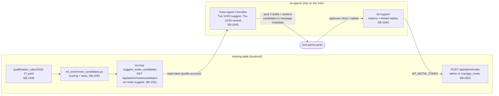

# Match of the Week agent: from fixtures to a pick (SB-1544 epic)

How MT suggests a Match of the Week, how a human approves it in Slack, and what an
agent may and may not claim. The pieces live in two repos.



## Contracts

| Step | Contract | Where |
|---|---|---|
| Rules | Each route is `confirmed` or not, cites a source; `slots: null` = not published, never 0 | [mls-next-qualification-data-model.md](../mls-next-qualification-data-model.md#built-qualification-rules-yaml-sb-1549) |
| Candidates | Score = 0.40 quality + 0.25 closeness + 0.20 stakes + 0.15 form; facts with ids `<match_id>:<slug>`; coverage always; `current_pick` if the week is taken | [featured-matches.md](../featured-matches.md#suggesting-candidates-sb-1550) |
| Drafts | Every reason cites a fact id; numbers must appear in a cited fact; a `confirmed: false` fact may only be stated as unconfirmed; qualification talk needs a rule fact; reasons ≤200 chars, blurb ≤280 | sb-agents `docs/notes/motw-agent.md` |
| Approval | Approver allow-list (`MOTW_APPROVERS`); deterministic thread grammar, no model; re-checks the week and asks before overwriting | sb-agents `docs/notes/motw-agent.md` |
| Write | Service-account JWT with only `manage_motw`; the pick records `selected_by_service` | [featured-matches.md](../featured-matches.md#the-motw-agents-account-sb-1553) |

## What an agent may say

- Stakes only from rule facts. A Homegrown league table (Northeast) has no "qualifying
  line": no source ties a league finish to a Cup place.
- Absent is not zero: a team with no games has no position, not "0 points from 0".
  Player facts are never produced (goals are user data).
- Never replace an existing pick without a human confirming it.

## Operating it

```bash
mt --env prod motw suggest --week 2026-11-14 --facts     # what the agent will see
# sb-agents, no Slack post:
op run --env-file=.env.op --env-file=.env.mt.op -- uv run motw-agent suggest --week 2026-11-14 --dry-run
```

Setup steps (Slack scopes, ConfigMap, token, deploy) are in sb-agents
`docs/notes/motw-agent.md`. Tuning weights: `WEIGHTS` in `motw_candidates.py`.
